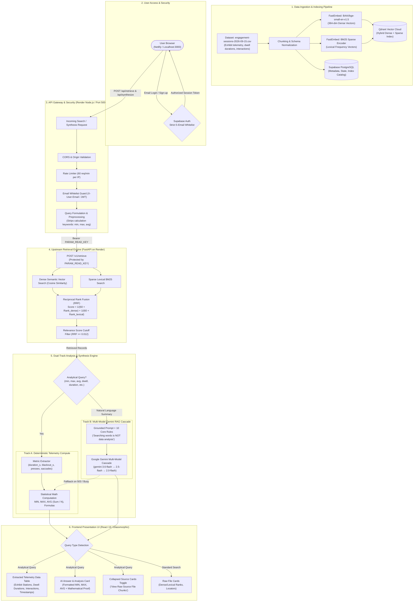

# Param Knowledge Retrieval & Telemetry Analytics Studio
## Complete End-to-End System Workflow & Technical Architecture

---

## 1. High-Level Architecture Diagram

---

## 2. Step-by-Step Technical Lifecycle

### Phase 1: Data Ingestion & Vector Indexing
1. **Source Data**: Museum visitor interaction logs (`engagement-sessions-2026-09-15.csv`) tracking exhibit sessions, stations (`Visual Cortex Lab`, `Perception Wing`, `Chamber Delta`), dwell durations (`duration_s`, `mean_blackout_duration_s`), and user interactions (`presses`, `saccade_count`, `slider_adjustments`).
2. **Dual Vector Generation**:
   - **Dense Vectors**: `BAAI/bge-small-en-v1.5` creates 384-dimensional semantic embeddings capturing conceptual meaning.
   - **Sparse Vectors**: BM25 model extracts term-frequency tokens for exact keyword matching.
3. **Indexing**: Both vectors are stored together in **Qdrant Vector Cloud**, and relational session metadata is stored in **Supabase PostgreSQL**.

---

### Phase 2: User Access & Strict Security Whitelist
1. The user visits the web app (`https://param-search-studio.netlify.app` or `http://localhost:3000`).
2. **Strict Email Guard**: Only 5 verified team email addresses are permitted:
   - `mantriramitha.cs24@bmsce.ac.in`
   - `mantriramitha17@gmail.com`
   - `maheshx43a@gmail.com`
   - `amitraksharmukherjee@gmail.com`
   - `ml9079725@gmail.com`
3. All authentication sessions are signed and verified via **Supabase Auth**. Non-whitelisted emails are rejected at both frontend and API gateway levels.

---

### Phase 3: API Gateway & Query Formulation
1. Search requests are sent to the Express API Gateway (`/backend`).
2. **Rate Limiting**: `express-rate-limit` enforces a maximum of 60 requests per minute per IP.
3. **Query Formulation**:
   - Standard semantic queries pass through directly.
   - Analytical queries (e.g., *"what is the minimum, maximum, and average dwell duration across exhibits?"*) are stripped of calculation keywords (`min`, `max`, `average`, `highest`, `lowest`) before sending to BM25.
   - **Why?** BM25 searches for rows containing literal words. Stripping calculation words ensures BM25 searches for the **actual entity and metric** (`dwell duration exhibits`), preventing empty or irrelevant keyword matches.

---

### Phase 4: Hybrid RRF Retrieval & Cutoff Filtering
1. The gateway makes a secure server-to-server call to the **FastAPI Retrieval Engine** on Render using the private `PARAM_READ_KEY`.
2. The engine executes **Hybrid Search** simultaneously across:
   - Dense vector space (semantic similarity).
   - Sparse lexical space (exact term matching).
3. **Reciprocal Rank Fusion (RRF)** combines the scores:
   $$\text{RRF Score} = \frac{1}{60 + \text{Rank}_{\text{dense}}} + \frac{1}{60 + \text{Rank}_{\text{lexical}}}$$
4. **Relevance Cutoff**: Chunks below the relevance threshold ($RRF < 0.012$) are discarded to eliminate noise.

---

### Phase 5: Telemetry Extraction & Deterministic Computation
1. Extracted records are passed to the **Telemetry Compute Engine**:
   - Parses duration fields across exhibit stations (`duration_s`, `mean_blackout_duration_s`, `fixation_duration_s`, `matching_duration_s`, `session_total_min`).
   - Parses interaction metrics (`presses`, `reported_disappearances`, `saccade_count`, `slider_adjustments_count`).
2. Performs exact arithmetic computations:
   - **$\text{MIN}$**: Finds minimum value and identifies the exhibit.
   - **$\text{MAX}$**: Finds maximum value and identifies the exhibit.
   - **$\text{AVG}$**: Computes arithmetic mean:
     $$\text{Average} = \frac{\sum_{i=1}^{N} \text{value}_i}{N}$$
   - Shows the exact formula and sample values for verification.

---

### Phase 6: Multi-Model Gemini RAG Cascade
1. The evidence chunks and user question are passed to **Google Gemini** with a strict 10-rule system instruction:
   - *"Searching for words is NOT data analysis. Never answer a numerical query merely because a row contains words like 'max' or 'min'."*
   - *"Only use values that actually exist in the records. Do not fabricate or hallucinate."*
2. **Model Cascade**:
   $$\text{models/gemini-3.6-flash} \longrightarrow \text{models/gemini-2.5-flash} \longrightarrow \text{models/gemini-2.0-flash}$$
3. **Zero-Error Fallback**: If remote LLM APIs experience high demand (503), the engine automatically falls back to the deterministic compute engine, ensuring the user always receives exact mathematical answers.

---

### Phase 7: Clean Presentation UI (Data Over Files)
1. **Dynamic View Switching**:
   - For question/analytical queries: **Raw file cards are hidden by default** to avoid cluttering the screen.
   - The **AI Answer & Analysis** panel opens automatically with the calculated metrics and formulas.
   - The **Extracted Telemetry Data Table** displays rows with Exhibit Station, Dwell Duration, Interactions, and UTC Timestamps.
   - A toggle button (`View Raw Source File Chunks`) allows users to inspect raw source cards on demand.
2. For keyword/document queries: Standard ranked result cards with RRF badges, Dense/BM25 rank pills, and JSON inspector are displayed.

---

## 3. Infrastructure & Deployment Topology

| Component | Technology | Hosting Platform | URL |
| :--- | :--- | :--- | :--- |
| **Frontend Studio** | React 19, Vite, Lucide | **Netlify** | [https://param-search-studio.netlify.app](https://param-search-studio.netlify.app) |
| **API Gateway** | Node.js, Express, Rate Limit | **Render** | [https://param-retrieval-backend.onrender.com](https://param-retrieval-backend.onrender.com) |
| **Retrieval Engine** | Python, FastAPI, FastEmbed | **Render** | [https://param-retrieval.onrender.com](https://param-retrieval.onrender.com) |
| **Vector Database** | Qdrant Hybrid (Dense + Sparse) | **Qdrant Cloud** | Managed Cloud Cluster |
| **Metadata & Auth** | PostgreSQL, GoTrue Auth | **Supabase** | Cloud Project `adtxcydewzfxszfuhhro` |
| **LLM Synthesis** | Gemini 3.6 Flash / Flash 2.5 | **Google AI Studio** | REST v1beta API |
