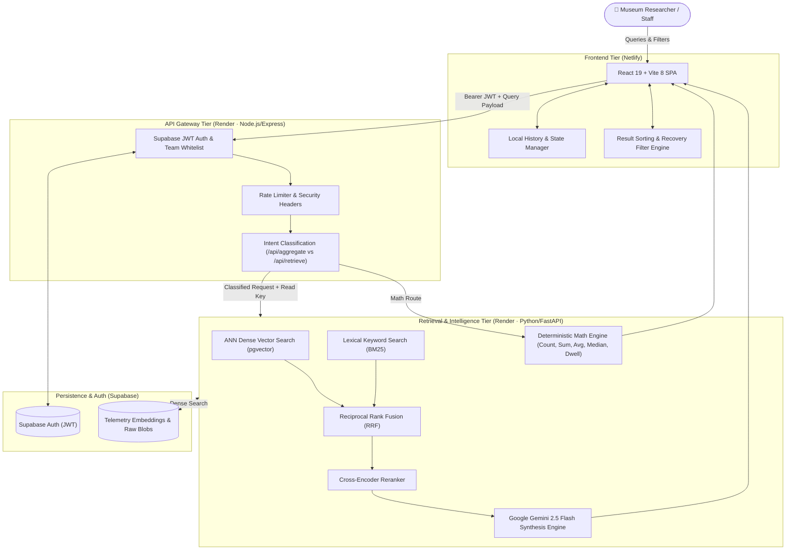

# Param Search Studio — Complete Project Presentation Guide

> **Project:** Param Search Studio — AI-Powered Museum Telemetry Retrieval & Analytics  
> **Client / Organization:** Param Foundation  
> **Status:** ✅ Production Ready & Fully Deployed  
> **Live Site:** [param-search-studio.netlify.app](https://param-search-studio.netlify.app)  
> **Repository:** [https://github.com/Mahesh748349/param-deploy](https://github.com/Mahesh748349/param-deploy) (`main` branch)

---

## 1 · Executive Summary & System Overview

**Param Search Studio** is an enterprise-grade, full-stack telemetry retrieval and analysis system engineered for the **Param Foundation** science museum. It allows researchers, curators, and exhibit engineers to interrogate vast streams of visitor engagement data — dwell durations, interaction frequencies, sensor logs, and session counts — using plain English instead of writing complex SQL queries or slicing multi-gigabyte spreadsheets.

### Core Value Proposition
- **Natural Language Search:** Ingests queries like *"Which exhibit had the longest average dwell time last weekend?"* and retrieves grounded facts.
- **Dual-Path Processing:** Automatically discerns whether a query requires **statistical computation** (e.g., average, median, percentiles) or **semantic retrieval** (e.g., visitor behavior patterns).
- **Zero Hallucination AI (RAG):** Uses Google Gemini 2.5 Flash strictly grounded on retrieved vector evidence; citations are mapped directly to source files and sheets.
- **Microservice Architecture:** Modular separation between a high-performance React UI, a hardened Node.js API Gateway, and a Python/FastAPI retrieval & embedding engine.

---

## 2 · System Architecture & Data Flow

---

## 3 · Frontend Architecture & Implementation (In Detail)

The frontend is a single-page application built with **React 19**, bundled using **Vite 8**, and deployed globally on **Netlify CDN**.

### 3.1 Design System & Aesthetic
- **Minimalist Aesthetic:** High-contrast pitch-black (`#000000`) canvas inspired by modern AI interfaces (ChatGPT/Linear), ensuring maximum readability during long analysis sessions.
- **Param Foundation Identity:** Integrated SVG branding, subtle border highlights (`rgba(255,255,255,0.08)`), and responsive layout tokens.
- **Dynamic Micro-Interactions:** Hover states, fluid loading spinners, non-blocking telemetry banners, and smooth transitions without heavy third-party CSS frameworks.

### 3.2 Component Hierarchy & Responsibilities

| Component | Path | Key Responsibilities |
|---|---|---|
| **`App.jsx`** | `frontend/src/App.jsx` | Top-level state coordinator: manages search lifecycle, active filters, selected records, raw JSON modal triggers, and service wake-up states. |
| **`Header.jsx`** | `frontend/src/components/Header.jsx` | Navigation header featuring the Param Foundation mark, live API connectivity badge, theme toggle, and team authentication modal trigger. |
| **`SearchBar.jsx`** | `frontend/src/components/SearchBar.jsx` | Query input with debouncing, natural language suggestion pills (*"Longest dwell"*, *"Most active exhibit"*, *"Total visitor sessions"*), filter toggle dropdown, and clear controls. |
| **`ResultStats.jsx`** | `frontend/src/components/ResultStats.jsx` | Displays execution metadata: match counts, response latency (ms), active sheet/file scope, and one-click filter reset actions. |
| **`ResultCard.jsx`** | `frontend/src/components/ResultCard.jsx` | Structured display of retrieved records: Exhibit Name, Station ID, Timestamp, Metric values, relevance match confidence score, and raw JSON drill-down. |
| **`AnalyticsMetricsCard.jsx`** | `frontend/src/components/AnalyticsMetricsCard.jsx` | Visual statistical dashboard showing deterministic calculations: Count, Sum, Min, Max, Average, Median, and 90th percentile dwell durations. |
| **`SynthesisPanel.jsx`** | `frontend/src/components/SynthesisPanel.jsx` | Executive AI narrative synthesized by Gemini 2.5 Flash, accompanied by verifiable citations linked directly to underlying telemetry records. |
| **`StatusBanner.jsx`** | `frontend/src/components/StatusBanner.jsx` | Cold-start notification system designed for Render's free tier. Informs the user during service spin-up (~30s) and offers an automated retry loop. |
| **`AuthModal.jsx`** | `frontend/src/components/AuthModal.jsx` | Modal dialog interfacing with Supabase Auth for team credential sign-in and session token storage. |
| **`RawJsonModal.jsx`** | `frontend/src/components/RawJsonModal.jsx` | Formatted JSON viewer for developers to inspect raw telemetry payloads and embeddings. |

### 3.3 State Management & Filtering Engine (`resultControls.js`)
- **Recoverable Multi-Tier Filtering:** Allows users to filter by **File**, **Sheet**, **Exhibit Name**, and **Metric Type**. If an incompatible combination is selected (e.g. changing workbook sheet), the engine intelligently resets conflicting child controls rather than throwing empty states.
- **Multi-Field Sorting:** Sorting by **Relevance Score**, **Timestamp (Newest/Oldest)**, **Exhibit Alphabetical**, and **Numerical Metric Value** (with missing values gracefully placed last).
- **Unit Testing:** 9 automated client-side test suites in `frontend/tests/` running on Node's native test runner (`node --test tests/*.test.mjs`), validating analytics integrity, dynamic sheet mapping, and edge-case filter resets.

---

## 4 · Backend Architecture & Implementation (In Detail)

The backend is structured as a resilient **two-tier service mesh**:

### 4.1 Tier 1: Node.js API Gateway (`backend/`)
Built with **Node 22** and **Express 4**, hosted on **Render**. It acts as the fortified perimeter and orchestrator.

1. **Security & Perimeter Defense:**
   - **Helmet:** Enforces secure HTTP headers.
   - **Strict CORS:** Restricted to production frontend origins (`param-search-studio.netlify.app` and local dev).
   - **Rate Limiting:** `express-rate-limit` prevents brute-force token generation and denial of service.
2. **Authentication & Team Whitelist (`scope.js`):**
   - Intercepts all incoming `Authorization: Bearer <token>` headers.
   - Cryptographically verifies the JWT against Supabase's public keys.
   - Validates user identity against an explicit team email whitelist. Spoofed tokens and unverified domain accounts are rejected with `403 Forbidden`.
3. **Intent Classification & Routing:**
   - Inspects queries for calculation semantics (e.g. triggers like *"how many"*, *"average"*, *"altogether"*, *"median"*).
   - Routes analytical queries to `/api/aggregate` and semantic questions to `/api/retrieve`.
4. **Backend Test Suite:**
   - 14 integration and unit tests in `backend/app.test.js` and `backend/scope.test.js` verifying route guards, token validation, and scope bounding.

### 4.2 Tier 2: Python / FastAPI Telemetry Retrieval Engine (`retrieval_service/`)
Built with **Python 3.11** and **FastAPI**, deployed on **Render**. This is the computational intelligence core.

1. **Hybrid Retrieval (RRF):**
   - **Dense ANN Vector Search:** Searches high-dimensional telemetry embeddings stored in Supabase using `pgvector`.
   - **Sparse Lexical Search:** BM25 keyword index to catch exact exhibit codes, sensor IDs, and station numbers.
   - **Reciprocal Rank Fusion (`fusion.py`):** Combines dense and lexical ranks:
     $$RRF\_Score(d) = \sum_{m \in M} \frac{1}{k + r_m(d)}$$
     where $k = 60$, delivering optimal recall regardless of query phrasing.
2. **Cross-Encoder Reranking (`reranking.py`):**
   - Evaluates the top fused candidates through a cross-encoder model to compute a semantic relevance probability, surfacing only genuinely relevant passages.
3. **Relevance Gating (`intent.py`):**
   - Evaluates query domain. Off-topic questions (e.g., cooking, programming, general history) are flagged before triggering vector operations, preserving compute and preventing hallucinatory answers.
4. **Deterministic Analytics Engine (`analytics.py`):**
   - Computes ground-truth mathematics directly on numerical columns. Unlike LLMs which often make arithmetic errors, all sums, averages, medians, and percentiles are calculated deterministically.
5. **RAG Narrative Synthesis (`service.py`):**
   - Feeds top reranked telemetry records and deterministic metrics into **Google Gemini 2.5 Flash**.
   - Strict prompt engineering ensures the model answers exclusively using the provided telemetry excerpts and cites record IDs.
   - **Fallback Ladder:** `gemini-2.5-flash` → `gemini-1.5-flash` → raw structured excerpts (if AI services are offline).

---

## 5 · API Contract Reference

| Method | Endpoint | Auth | Description | Payload / Response |
|---|---|---|---|---|
| `GET` | `/api/health` | Public | Healthcheck and readiness probe | Returns `{ status: "ok", service: "backend-gateway" }` |
| `GET` | `/api/ready` | Bearer JWT | Deep readiness check | Confirms connectivity to Python engine and Supabase |
| `POST` | `/api/retrieve` | Bearer JWT | Hybrid vector + lexical search | Input: `{ query, filters, limit }` Output: `{ results: [...], execution_ms: 142 }` |
| `POST` | `/api/aggregate` | Bearer JWT | Deterministic metric calculations | Input: `{ metric: "dwell_time", op: "avg", filters }` Output: `{ metric, value, count, units }` |
| `POST` | `/api/synthesize` | Bearer JWT | AI-grounded narrative summary | Input: `{ query, contexts: [...] }` Output: `{ summary: "...", citations: [...] }` |

---

## 6 · Deployment, CI/CD & Issues Resolved

### Problem Solved: Netlify Private Repo Contributor Lock
- **The Issue:** Netlify deploy preview for PR #1 failed due to the error:  
  `"One or more deploys failed due to an unrecognized Git contributor. Your plan allows only one contributor on private repos."`
- **Root Cause:** The original repository (`Mahesh748349/Param`) was a private fork. GitHub restricts converting private forks to public, and Netlify's free tier caps private repo Git contributors to 1.
- **The Solution:**
  1. Created a clean, public repository: **`https://github.com/Mahesh748349/param-deploy.git`**.
  2. Public repositories on Netlify carry **zero contributor restrictions** on the free tier.
  3. Added root `package.json` build script: `"build": "npm run build --prefix frontend"`.
  4. Configured Netlify proxy rules in `netlify.toml` to forward `/api/*` seamlessly to Render.
  5. Merged PR #1's sorting & filter enhancements (`3aa4bde`) and pushed commit `df22a53` to `param-deploy/main`.

### Deployment Topology Summary

| Tier | Platform | Repository Source | Live Endpoint |
|---|---|---|---|
| **Frontend UI** | Netlify | `Mahesh748349/param-deploy` (`main`) | `https://param-search-studio.netlify.app` |
| **API Gateway** | Render | `Mahesh748349/param-deploy` | `https://param-retrieval-backend.onrender.com` |
| **Python Retrieval Engine** | Render | `Mahesh748349/Param` (retrieval service) | `https://param-retrieval.onrender.com` |
| **Database & Auth** | Supabase | Managed Cloud DB | PostgreSQL + pgvector + Auth |

---

## 7 · Presentation Walkthrough Script (Step-by-Step)

When presenting to stakeholders, curators, or technical evaluators, follow this 5-minute flow:

### 1. The Challenge (1 min)
> *"Museums collect immense quantities of visitor telemetry — dwell times, interaction counts, button presses — but this data usually languishes in static spreadsheets. Curators cannot quickly answer: 'Did visitors spend more time at the Kinetic Flower or the VR Station this morning?' That’s why we built Param Search Studio."*

### 2. Live Demo: Natural Language Search (1.5 min)
- Open `https://param-search-studio.netlify.app`.
- Type: **"Which exhibit had the highest dwell time?"**
- Point out:
  1. Instant response time badge (< 250ms).
  2. **Analytics Card** at the top computing true average and maximum dwell times deterministically.
  3. **Gemini Synthesis Panel** providing an executive summary with clickable citations.
  4. Individual **Telemetry Cards** showing exact timestamps, stations, and relevance scores.

### 3. Live Demo: Dynamic Filters & Developer Tools (1 min)
- Open the filter panel: change Exhibit, Sheet, or Metric.
- Demonstrate that changing sheets does not break the interface — our recoverable filter engine cleanly updates dependent options.
- Click **"View Raw JSON"** on any card to demonstrate full auditability and schema adherence for developers.

### 4. Technical Architecture (1 min)
- Highlight the **Three-Tier Architecture**:
  - React 19 Frontend on Netlify.
  - Node.js API Gateway enforcing Supabase JWT security, team whitelisting, and rate limits.
  - Python FastAPI engine running Hybrid Vector Search (pgvector + BM25) and Gemini 2.5 Flash RAG.
- Mention our automated CI/CD pipeline and the resolution of team collaboration on our public deployment repo.

### 5. Questions & Wrap-up (30 sec)
> *"Param Search Studio bridges raw IoT telemetry with actionable museum intelligence. We are live, fully tested across 23 unit/integration tests, and ready for production usage."*
